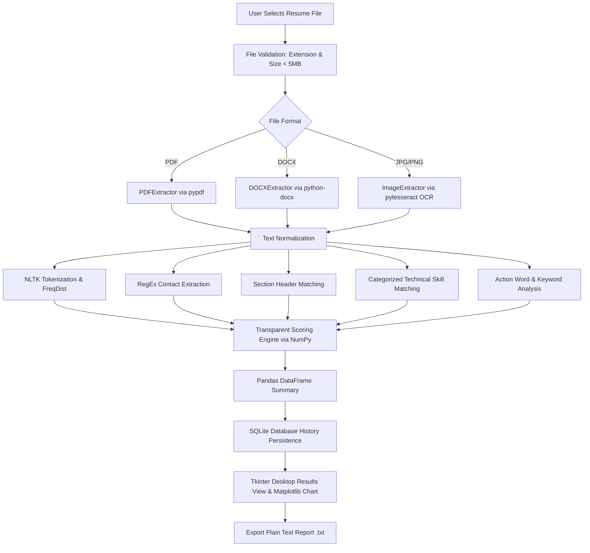

# Smart Resume Analyzer & Score Calculator

**University Python Mini-Project — B.Tech Computer Science and Engineering**

A standalone, professional Python Tkinter desktop application designed to evaluate resume documents (PDF, Word DOCX, JPG, JPEG, PNG), detect technical skills and section completeness, estimate career fields, calculate a transparent 100-point score, and generate actionable improvement suggestions.

---

## 1. Features

- **Multi-Format Extraction**: Supports PDF text extraction (`pypdf`), Word document parsing (`python-docx`), and image OCR scanning (`Pillow` + `pytesseract`).
- **Object-Oriented Design**: Utilizes an Abstract Base Class (`ResumeExtractor`) and polymorphic extractors for clean architecture.
- **Section Detection**: Identifies 10 core resume sections (Objective, Education, Technical Skills, Projects, Work Experience, Internships, Certifications, Achievements, Languages, Interests).
- **RegEx Contact Detail Extraction**: Automatically extracts Email, Phone Number, LinkedIn URL, and GitHub URL using Regular Expressions.
- **Categorized Technical Skill Matching**: Detects skills across 6 technical domains (Programming, Web Development, Databases, Data Science, AI/ML, Cloud & Tools) with strict regex word boundaries to avoid false positives (e.g., matching single letter 'C' inside words).
- **Action Word & Readability Analysis**: Analyzes professional action verb frequencies (e.g., *Developed*, *Designed*, *Automated*) and text readability depth.
- **Career-Field Estimation**: Classifies primary domain focus (Software Dev, Web Dev, Data Science, Data Analytics, AI/ML, Cloud Computing, Cybersecurity).
- **Transparent 100-Point Scoring System**: Rule-based rubric evaluating structure, skills, contact info, experience, action words, keywords, and readability.
- **Data Science & Visualization Integration**:
  - **NumPy**: Vectorized calculations, score validation (`np.clip`), and total sum aggregation (`np.sum`).
  - **Pandas**: Tabular DataFrames for score breakdown and resume statistics.
  - **Matplotlib**: Vertical bar chart embedded directly inside Tkinter window via `FigureCanvasTkAgg`.
  - **NLTK**: Tokenization (`RegexpTokenizer`) and word frequency distribution (`FreqDist`).
- **SQLite History Persistence**: Stores analysis records locally in `resume_analyzer_history.db` with parameterized queries and JSON serialization.
- **Report Export**: Generates readable plain-text `.txt` summary reports.
- **Responsive GUI**: Uses background thread execution (`threading.Thread`) to keep the Tkinter interface fluid during file parsing.

---

## 2. Project Architecture & File Responsibilities

```
SmartResumeAnalyzerDesktop/
│
├── main.py            # Application entry point & DPI setup
├── gui.py             # Tkinter desktop interface, canvas score ring, Matplotlib chart & navigation
├── extractor.py       # OOP text extraction module (PDF, DOCX, Image OCR)
├── analyzer.py        # NLTK tokenization, RegEx contact parsing, skill & section matching
├── scorer.py          # 100-point transparent scoring engine (NumPy & Pandas integration)
├── database.py        # SQLite history storage (sqlite3, parameterized queries, JSON)
├── report.py          # Plain text report generator and File I/O saver
├── requirements.txt   # External Python package dependencies
├── .gitignore         # Excluded virtual environments and temporary database files
└── README.md          # Comprehensive documentation, setup guide & viva Q&A
```

---

## 3. Workflow Diagram



---

## 4. Fresh Windows Installation & Setup Guide

### Step 1: Clone or Open Project Folder
Open PowerShell or Command Prompt in your project directory:
```powershell
cd d:\edu\Projectworks\python mini final\SmartResumeAnalyzerDesktop
```

### Step 2: Create Python Virtual Environment
```powershell
python -m venv venv
```

### Step 3: Activate Virtual Environment
```powershell
venv\Scripts\activate
```

### Step 4: Install Dependencies
```powershell
pip install -r requirements.txt
```

### Step 5: Run Application
```powershell
python main.py
```

---

## 5. Tesseract OCR Installation Guide (Windows)

Image OCR (JPG, JPEG, PNG) requires the Tesseract OCR engine installed on Windows.

1. Download the Windows installer from GitHub UB-Mannheim:
   `https://github.com/UB-Mannheim/tesseract/wiki`
2. Run the installer (default path: `C:\Program Files\Tesseract-OCR\tesseract.exe`).
3. Add `C:\Program Files\Tesseract-OCR` to your Windows System PATH environment variable.
4. If Tesseract is not installed, PDF and DOCX file processing will work completely fine. Image files will show a friendly installation prompt dialog instead of crashing.

---

## 6. Score Calculation Breakdown (100-Point Rubric)

| Category | Maximum Score | Evaluation Criteria |
|---|---:|---|
| **Resume Structure** | **20** | Presence of key section headings (Objective, Education, Skills, Projects, Experience). |
| **Technical Skills** | **20** | Tiered scoring based on detected technical skills count across 6 categories. |
| **Projects & Experience** | **20** | Detection of Projects/Work Experience sections and content depth. |
| **Contact Information** | **10** | Email (3 pts), Phone (3 pts), LinkedIn URL (2 pts), GitHub URL (2 pts). |
| **Professional Action Words** | **10** | Frequency of impactful action verbs (*Developed*, *Designed*, *Implemented*, etc.). |
| **Relevant Keywords & Depth** | **10** | Content density and technical keyword ratio. |
| **Readability & Text Quality** | **10** | Optimal word count (250–800 words) and vocabulary character length. |
| **TOTAL** | **100** | **Grade: Excellent (90+), Very Good (75-89), Good (60-74), Needs Improvement (<60)** |

---

## 7. Syllabus Topic Mapping Table

| Syllabus Unit | Concept Demonstrated | Exact File & Function Location |
|---|---|---|
| **Unit 1: Python Basics** | Data Types, Lists, Dicts, Sets, Control Flow | `analyzer.py` -> `detect_skills()`, `detect_sections()` |
| **Unit 1: Functions** | Lambda Expressions for sorting | `analyzer.py` -> `analyze_action_words()`, `gui.py` |
| **Unit 2: Files & DB** | File I/O text report generation | `report.py` -> `generate_report_text()`, `save_report_to_file()` |
| **Unit 2: SQLite** | `sqlite3` DDL/DML, Parameterized Queries | `database.py` -> `init_db()`, `save_analysis_record()` |
| **Unit 3: OOP** | Abstract Base Classes, Inheritance, Polymorphism | `extractor.py` -> `ResumeExtractor`, `PDFExtractor`, `get_extractor()` |
| **Unit 3: NumPy** | Vectorized array operations, score clipping | `scorer.py` -> `compute_overall_score()`, `np.clip()`, `np.sum()` |
| **Unit 3: Pandas** | DataFrames for score breakdown tables | `scorer.py` -> `compute_overall_score()`, `gui.py` |
| **Unit 3: Matplotlib** | Bar chart embedded inside Tkinter GUI | `gui.py` -> `FigureCanvasTkAgg` in `show_results_view()` |
| **Unit 3: NLTK** | RegexpTokenizer, FreqDist word frequencies | `analyzer.py` -> `analyze_text_nltk()` |
| **Unit 3: RegEx** | Regular expressions for contact details & skills | `analyzer.py` -> `extract_contact_details()` |
| **Unit 4: Tkinter GUI** | Frames, ttk styles, Canvas score circle, Threading | `gui.py` -> `SmartResumeApp`, `CircularScoreCanvas` |

---

## 8. Common Viva Questions & Answers

**Q1: Why did you use an Abstract Base Class in `extractor.py`?**
*Answer*: `ResumeExtractor` defines a common contract (`extract_text()`). `PDFExtractor`, `DOCXExtractor`, and `ImageExtractor` inherit from it and implement file-specific extraction logic. This demonstrates **Abstraction**, **Inheritance**, and **Polymorphism**, allowing the app to process any file format uniformly using `get_extractor(file_path).extract_text()`.

**Q2: How are NumPy and Pandas used in the scoring engine?**
*Answer*: NumPy arrays (`np.array`) hold raw score components for vectorized calculations. We use `np.clip()` to enforce min/max bounds and `np.sum()` to calculate the aggregate score out of 100. Pandas organizes these scores into a structured `pd.DataFrame` containing category names, earned points, max points, and percentages.

**Q3: How is Matplotlib integrated into Tkinter without launching a separate window?**
*Answer*: We import `FigureCanvasTkAgg` from `matplotlib.backends.backend_tkagg` and pass a Matplotlib `Figure` object to it. Calling `get_tk_widget()` returns a native Tkinter widget that we pack directly into a Tkinter Frame container.

**Q4: How do you prevent single-letter skills like 'C' from matching inside ordinary words?**
*Answer*: We use custom Regular Expression lookarounds (`(?<![a-zA-Z0-9])C(?![a-zA-Z0-9+#])`) instead of naive substring searching (`"c" in text`). This guarantees that 'C' is matched only as an independent word boundary.

**Q5: How does the app keep the GUI responsive during heavy OCR file extraction?**
*Answer*: File extraction and NLTK analysis are dispatched to a background thread using Python's `threading.Thread`. Once processing completes, `root.after()` schedules UI widget updates back on the main GUI thread, preventing interface freezing.

---

## 9. Verification Checklist

- [x] Application launches as native Tkinter desktop program (`python main.py`).
- [x] Supports PDF, DOCX, JPG, JPEG, and PNG file formats.
- [x] Enforces 5 MB file size limit with native Tkinter error dialogs.
- [x] Calculates transparent score out of 100 based on actual extracted text.
- [x] Displays circular score indicator using custom Tkinter Canvas.
- [x] Renders embedded Matplotlib bar chart inside GUI.
- [x] SQLite database persists analysis records across application restarts.
- [x] Report can be exported as `.txt` file using native Save As dialog.
- [x] Fully offline operation without paid APIs or external web services.
